# 🐾 Harmony - 우리들의 이야기


# 🌟 서비스 소개

사람의 일상에 녹아들어 ‘유저들과 함께한다’는 느낌을 제공하고자 SNS서비스를 제작해 보았습니다.
기술이 단순 구현에 머무르지 않고 어떤 새로운 가치를 창출할 수 있을지 고민하고, 또 이를 구현한 프로젝트입니다.
이 서비스를  통해 친구들과 일상을 공유할 수 있고, 실시간 1:1 채팅도 가능합니다!


<br />
<br />

# 💡 주요 기능
 <br/>

### 검색
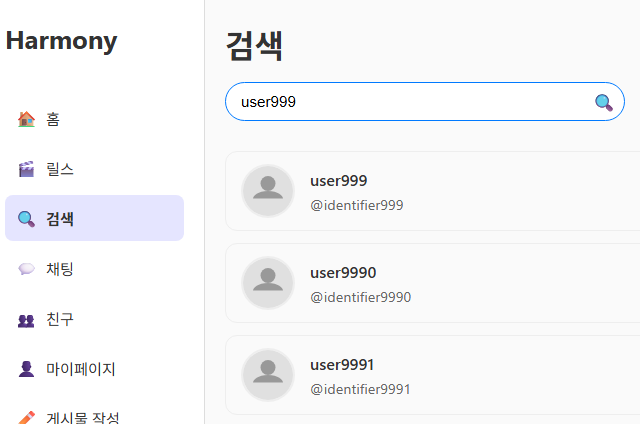

- 유저를 검색하는 기능입니다. :)
- 해당 기능은 user identifier나 nickname을 기준으로 검색하며, 최적화를 고려하고 있습니다.

 <br/>
 
### 차단(FE연동중)


- ⛔ SNS라면 빠질 수 없는 차단 기능입니다! 피드를 보고싶지 않다면 사용해 보세요.
- 진행중인 친구 추가 요청이 있다면 수신 건은 거절되며, 발신 건은 취소됩니다.

 <br/>
 
### 삭제
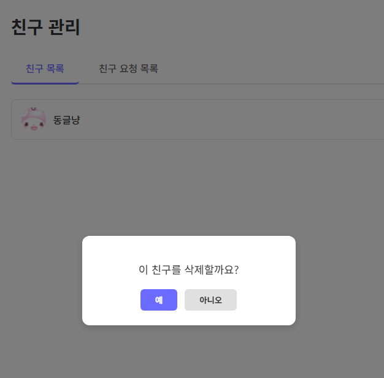

- 🤔 추가한 친구와의 관계를 다시 고려하고 계신다면.. 잠깐 삭제해 봅시다.
- 친구 탭의 목록 아이템에 호버했을 때 뜨는 X 버튼으로 삭제할 수 있습니다.

 <br/>
 
### 친구
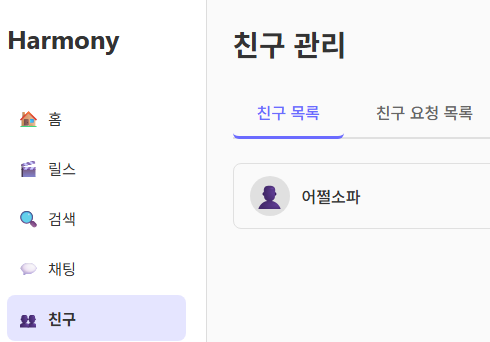

- 🤝 친구 탭에서 친구 목록을 관리할 수 있습니다!
- 홈 피드에서 친구들의 피드를 구경할 수 있습니다.

 <br/>
 
### 친구 추가
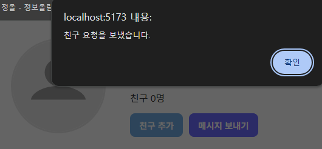
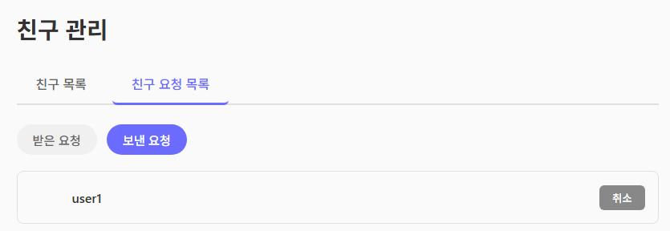
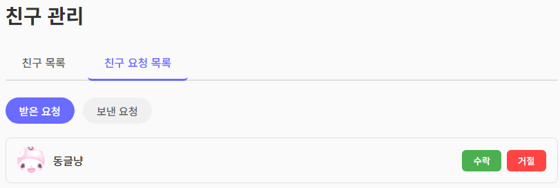

- ➕ 마음에 드는 사용자를 친구로 추가해 보세요.
- 수신하거나 발신한 친구 추가 건은 친구 탭 내 친구 요청 목록에서 관리할 수 있습니다.

 <br/>
 
### 채팅방
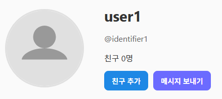
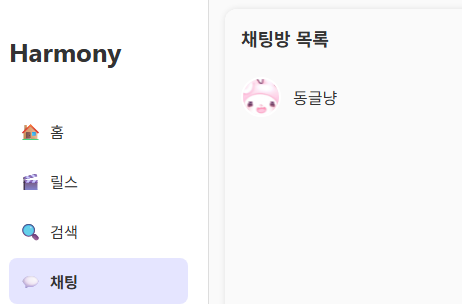

- 👥 사용자 검색 결과를 클릭해 채팅 메시지 보내기를 누르면, 채팅방이 개설됩니다.
- 현재 사이트는 1:1 개인 채팅이 구현되어 있습니다.

 <br/>
 
### 채팅 메시지
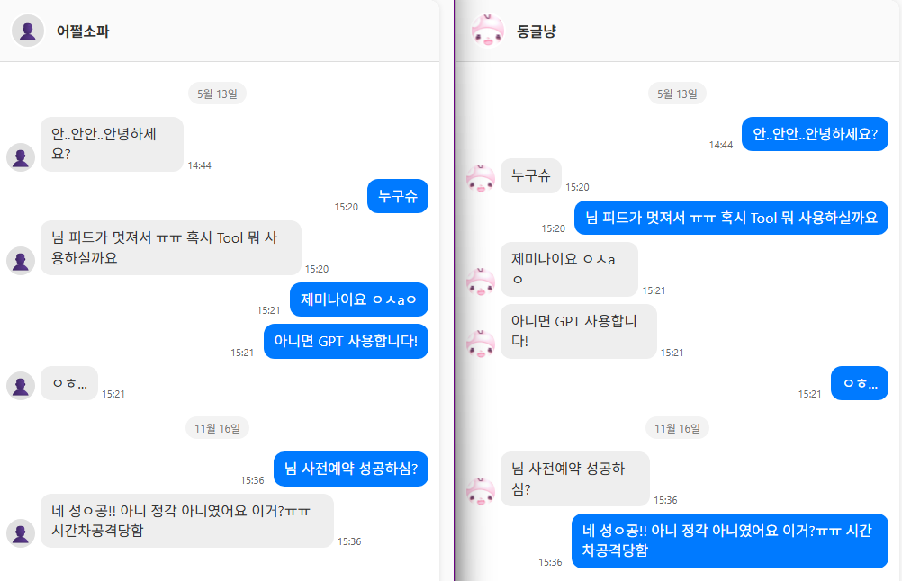

- 🗣️ 상대방과 실시간으로 텍스트를 통해 채팅할 수 있습니다.

 <br/>
 
### 게시물
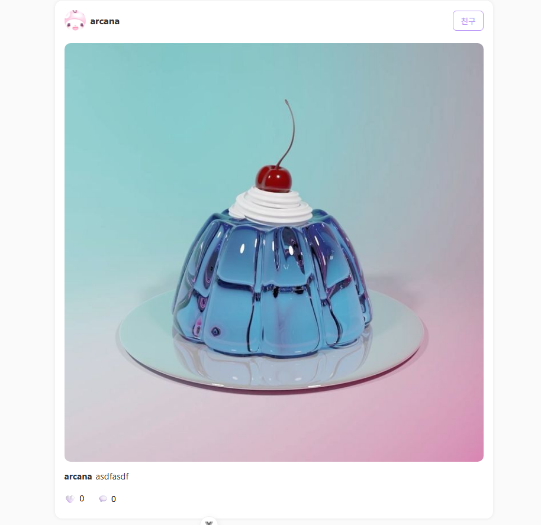
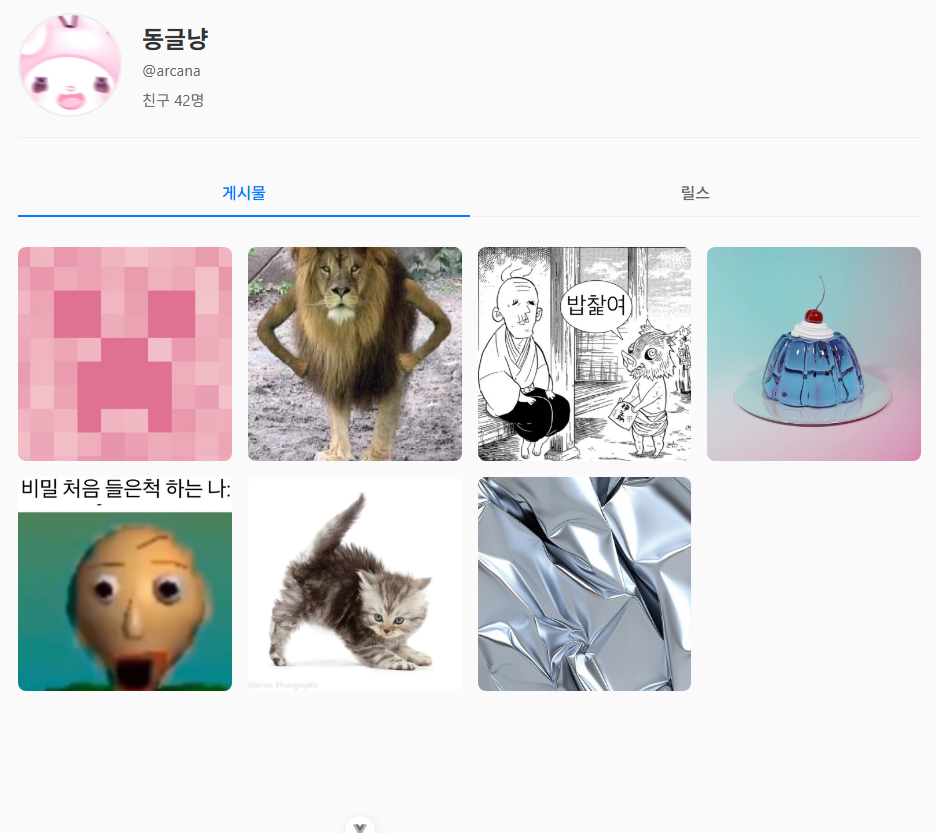
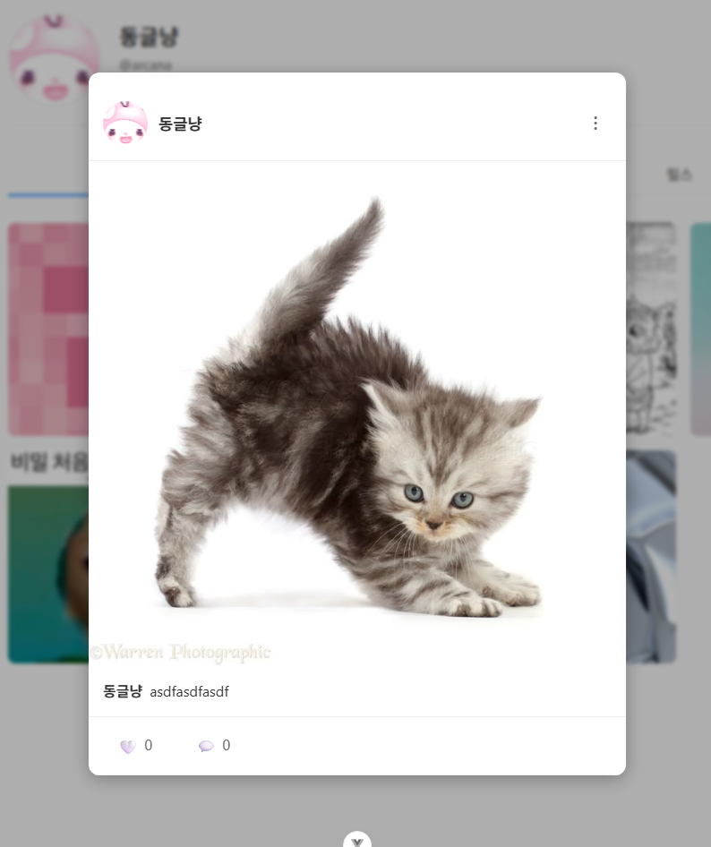

- 📝 당신의 일상을 공유해 보세요. 친구들의 홈 피드 탭에 보여지게 됩니다.

 <br/>
 
### 보안


- 🛡️ Spring Security와 JWT를 적용했습니다.
- 서비스 사용 시 사용자의 토큰을 확인합니다. 👀

 <br/>
 
### AWS S3


- 🖼️ S3 버킷으로 업로드한 이미지를 관리합니다.
- 파일명은 업로드할 때 랜덤으로 생성합니다!
- 프로필과 게시물 사진을 보관합니다.

 <br/>
 
### 댓글
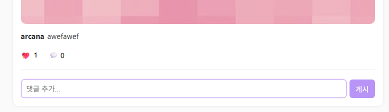
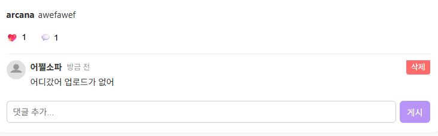

- 💬 피드의 댓글란에 당신의 이야기를 들려 주세요!
- 작성한 댓글에 호버하면, 삭제 버튼이 활성화됩니다.

 <br/>
 
### 좋아요
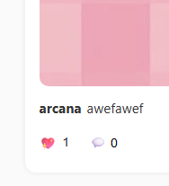

- 🩷 이 피드 최고..😭
- 마음에 든 피드에 좋아요를 전송해 보세요. 🙂
- 눌렀던 좋아요는 다시 눌러서 취소할 수 있습니다.

<br />
<br />


# 🛠️ 주요 기술 스택

-   Infra : (Docker로 배포할 예정)
-   BackEnd : Java, Spring Boot, JPA
-   FrontEnd : Vue
-   DataBase : MySQL, MongoDB
-   Etc : AmazonS3


<br />
<br />


# ⚙ 시스템 아키텍처
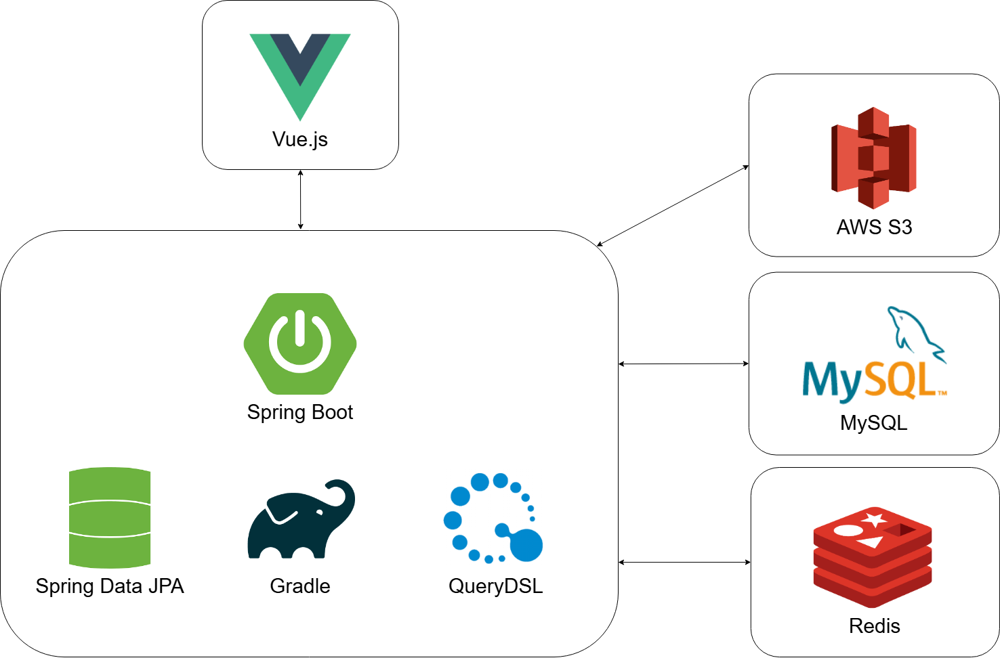


<br />
<br />


# 🐾 팀원 소개 및 프로젝트 기간
<table>
    <tr>
        <td height="140px" align="center"> 
             <br><br> 이아진 <br>(Full-Stack) </a> <br></td>  
    </tr>
    <tr>
        <td align="center">
        [BE] 
        <br/>
        [FE] with Github Copilot
        <br/></td>    
    </tr>
</table>


### 🐾 프로젝트 기간 : 2024.11 ~ 2026.03


<br />
<br />


# 📝 설계 문서

### ERD
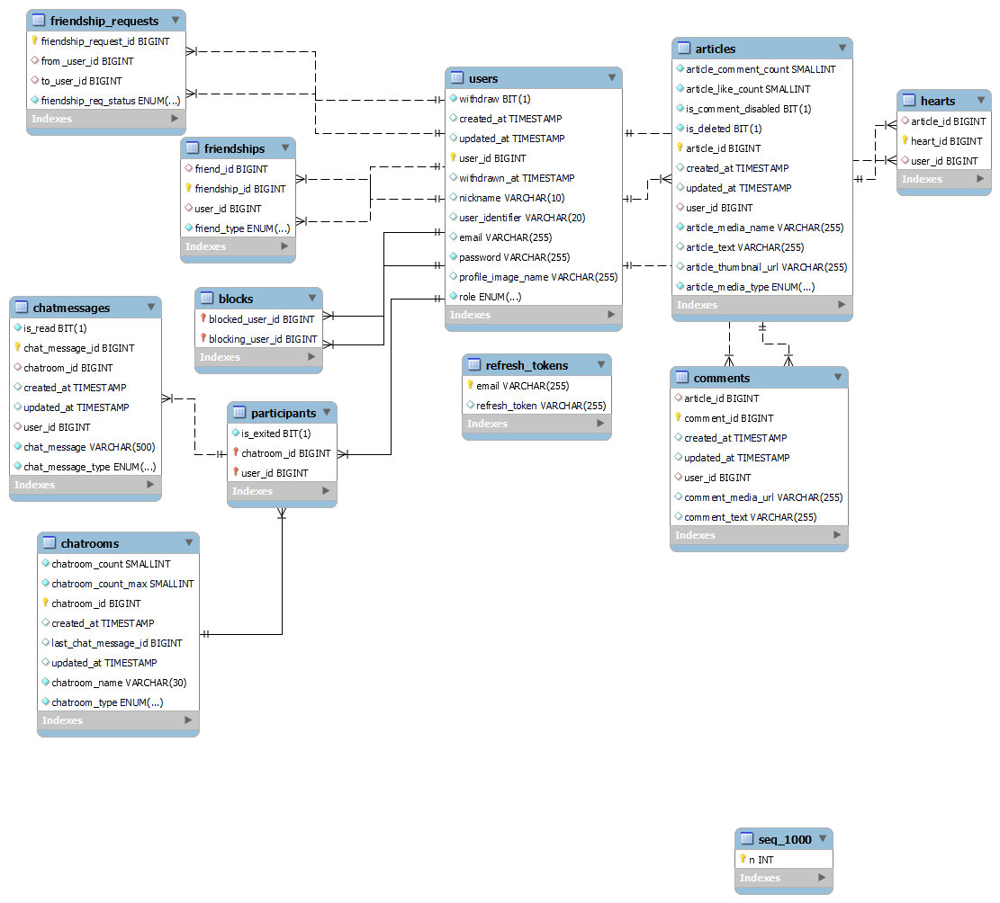

<br />

### [API 명세서](https://1drv.ms/x/c/ac1a29f8d6a1ad84/ASA8R-_qwA9MkAWhFjmfkNE?e=gu9PkY)

<br />

### 폴더 구조
```
📦harmony
 ┣ 📂controller
 ┃ ┣ 📜ArticleController.java
 ┃ ┣ 📜AuthController.java
 ┃ ┣ 📜AwsS3Controller.java
 ┃ ┣ 📜BlockController.java
 ┃ ┣ 📜ChatMessageController.java
 ┃ ┣ 📜ChatRoomController.java
 ┃ ┣ 📜CommentController.java
 ┃ ┣ 📜FriendshipController.java
 ┃ ┣ 📜FriendshipRequestController.java
 ┃ ┣ 📜HeartController.java
 ┃ ┣ 📜ParticipantController.java
 ┃ ┗ 📜UserController.java
 ┣ 📂dto
 ┃ ┣ 📂form
 ┃ ┃ ┣ 📜ArticleForm.java
 ┃ ┃ ┣ 📜ChatRoomNameForm.java
 ┃ ┃ ┣ 📜NicknameForm.java
 ┃ ┃ ┣ 📜PasswordForm.java
 ┃ ┃ ┗ 📜ProfileImageForm.java
 ┃ ┣ 📂request
 ┃ ┃ ┣ 📜BlockRequestDto.java
 ┃ ┃ ┣ 📜CancelSentFriendshipRequestRequestDto.java
 ┃ ┃ ┣ 📜ChatMessageRequestDto.java
 ┃ ┃ ┣ 📜CreateAndParticipateGroupChatRoomRequestDto.java
 ┃ ┃ ┣ 📜CreateAndParticipatePersonalChatRoomRequestDto.java
 ┃ ┃ ┣ 📜CreateFriendshipRequestDto.java
 ┃ ┃ ┣ 📜DeleteFriendshipRequestDto.java
 ┃ ┃ ┣ 📜LeaveChatRoomForceRequestDto.java
 ┃ ┃ ┣ 📜LeaveChatRoomRequestDto.java
 ┃ ┃ ┣ 📜LoginDto.java
 ┃ ┃ ┣ 📜ParticipateGroupChatRoomRequestDto.java
 ┃ ┃ ┣ 📜RegisterRequestDto.java
 ┃ ┃ ┣ 📜SearchUserRequestDto.java
 ┃ ┃ ┣ 📜SelectChatRoomParticipantsRequestDto.java
 ┃ ┃ ┣ 📜SelectProfileRequestDto.java
 ┃ ┃ ┣ 📜UnBlockRequestDto.java
 ┃ ┃ ┣ 📜UpdateReceivedFriendshipRequestStatusRequestDto.java
 ┃ ┃ ┣ 📜WriteArticleRequestDto.java
 ┃ ┃ ┗ 📜WriteCommentRequestDto.java
 ┃ ┗ 📂response
 ┃ ┃ ┣ 📜ChatMessageResponseDto.java
 ┃ ┃ ┣ 📜ReceivedFriendshipRequestResponseDto.java
 ┃ ┃ ┣ 📜ReissueResponseDto.java
 ┃ ┃ ┣ 📜SearchUserResponseDto.java
 ┃ ┃ ┣ 📜SelectAuthorArticlesResponseDto.java
 ┃ ┃ ┣ 📜SelectBlockResponseDto.java
 ┃ ┃ ┣ 📜SelectChatRoomMessagesResponseDto.java
 ┃ ┃ ┣ 📜SelectChatRoomParticipantsResponseDto.java
 ┃ ┃ ┣ 📜SelectCommentResponseDto.java
 ┃ ┃ ┣ 📜SelectFollowingUserArticlesResponseDto.java
 ┃ ┃ ┣ 📜SelectFriendshipResponseDto.java
 ┃ ┃ ┣ 📜SelectMyArticleHeartsResponseDto.java
 ┃ ┃ ┣ 📜SelectParticipatedChatRoomsResponseDto.java
 ┃ ┃ ┣ 📜SelectProfileResponseDto.java
 ┃ ┃ ┣ 📜SelectUserInfoResponseDto.java
 ┃ ┃ ┣ 📜SentFriendshipRequestResponseDto.java
 ┃ ┃ ┣ 📜SlicedResponseDto.java
 ┃ ┃ ┗ 📜WriteCommentResponseDto.java
 ┣ 📂entity
 ┃ ┣ 📜Article.java
 ┃ ┣ 📜ArticleMediaType.java
 ┃ ┣ 📜Block.java
 ┃ ┣ 📜BlockId.java
 ┃ ┣ 📜ChatMessage.java
 ┃ ┣ 📜ChatMessageType.java
 ┃ ┣ 📜ChatRoom.java
 ┃ ┣ 📜ChatRoomType.java
 ┃ ┣ 📜Comment.java
 ┃ ┣ 📜Friendship.java
 ┃ ┣ 📜FriendshipRequest.java
 ┃ ┣ 📜FriendshipRequestStatus.java
 ┃ ┣ 📜FriendType.java
 ┃ ┣ 📜Heart.java
 ┃ ┣ 📜Participant.java
 ┃ ┣ 📜ParticipantId.java
 ┃ ┣ 📜RefreshToken.java
 ┃ ┣ 📜Role.java
 ┃ ┗ 📜User.java
 ┣ 📂env
 ┃ ┣ 📂util
 ┃ ┃ ┗ 📜SchedulerUtil.java
 ┃ ┣ 📜EnvConfig.java
 ┃ ┣ 📜QueryDslConfig.java
 ┃ ┣ 📜RedisCacheConfig.java
 ┃ ┣ 📜RedisConfig.java
 ┃ ┣ 📜SchedulerConfig.java
 ┃ ┗ 📜SecurityConfig.java
 ┣ 📂exception
 ┃ ┣ 📜AlreadyCanceledFriendshipRequestException.java
 ┃ ┣ 📜AuthFailedException.java
 ┃ ┣ 📜DuplicatedUserInfoException.java
 ┃ ┣ 📜DuplicatedUserNicknameException.java
 ┃ ┣ 📜DuplicatedUserPasswordException.java
 ┃ ┣ 📜ExpiredTokenException.java
 ┃ ┣ 📜GroupChatRoomFullException.java
 ┃ ┣ 📜InvalidTokenException.java
 ┃ ┣ 📜LoginFailedException.java
 ┃ ┣ 📜SecurityContextNotFoundException.java
 ┃ ┗ 📜UserAlreadyWithdrawException.java
 ┣ 📂global
 ┃ ┣ 📂annotation
 ┃ ┃ ┣ 📜CurrentUserId.java
 ┃ ┃ ┗ 📜CurrentUserIdArgumentResolver.java
 ┃ ┣ 📂config
 ┃ ┃ ┣ 📜AwsS3Config.java
 ┃ ┃ ┣ 📜JpaAuditingConfig.java
 ┃ ┃ ┣ 📜StompConfig.java
 ┃ ┃ ┣ 📜SwaggerConfig.java
 ┃ ┃ ┣ 📜WebConfig.java
 ┃ ┃ ┗ 📜WebSocketMessageBrokerStatsConfig.java
 ┃ ┣ 📂response
 ┃ ┃ ┣ 📂code
 ┃ ┃ ┃ ┣ 📜ErrorCode.java
 ┃ ┃ ┃ ┣ 📜ResponseCode.java
 ┃ ┃ ┃ ┗ 📜SuccessCode.java
 ┃ ┃ ┣ 📂exception
 ┃ ┃ ┃ ┣ 📜BusinessException.java
 ┃ ┃ ┃ ┣ 📜EntityAlreadyExistException.java
 ┃ ┃ ┃ ┣ 📜EntityNotFoundException.java
 ┃ ┃ ┃ ┣ 📜FormValidationException.java
 ┃ ┃ ┃ ┣ 📜InvalidArgumentException.java
 ┃ ┃ ┃ ┗ 📜UploadFailedException.java
 ┃ ┃ ┣ 📂handler
 ┃ ┃ ┃ ┣ 📜GlobalExceptionHandler.java
 ┃ ┃ ┃ ┗ 📜StompExceptionHandler.java
 ┃ ┃ ┗ 📂structure
 ┃ ┃ ┃ ┣ 📜ErrorResponse.java
 ┃ ┃ ┃ ┗ 📜SuccessResponse.java
 ┃ ┗ 📜BaseTime.java
 ┣ 📂interceptor
 ┃ ┗ 📜ChannelInboundInterceptor.java
 ┣ 📂repository
 ┃ ┣ 📂querydsl
 ┃ ┃ ┣ 📂impl
 ┃ ┃ ┃ ┣ 📜DslArticleRepositoryImpl.java
 ┃ ┃ ┃ ┣ 📜DslChatMessageRepositoryImpl.java
 ┃ ┃ ┃ ┣ 📜DslFriendshipRepositoryImpl.java
 ┃ ┃ ┃ ┗ 📜DslFriendshipRequestRepositoryImpl.java
 ┃ ┃ ┣ 📜DslArticleRepository.java
 ┃ ┃ ┣ 📜DslChatMessageRepository.java
 ┃ ┃ ┣ 📜DslFriendshipRepository.java
 ┃ ┃ ┗ 📜DslFriendshipRequestRepository.java
 ┃ ┣ 📜ArticleRepository.java
 ┃ ┣ 📜BlockRepository.java
 ┃ ┣ 📜ChatMessageRepository.java
 ┃ ┣ 📜ChatRoomRepository.java
 ┃ ┣ 📜CommentRepository.java
 ┃ ┣ 📜FriendshipRepository.java
 ┃ ┣ 📜FriendshipRequestRepository.java
 ┃ ┣ 📜HeartRepository.java
 ┃ ┣ 📜ParticipantRepository.java
 ┃ ┣ 📜RefreshTokenRepository.java
 ┃ ┗ 📜UserRepository.java
 ┣ 📂security
 ┃ ┣ 📂filter
 ┃ ┃ ┣ 📜AuthenticationFilter.java
 ┃ ┃ ┗ 📜CustomExceptionFilter.java
 ┃ ┣ 📂handler
 ┃ ┃ ┣ 📜JwtAccessDeniedHandler.java
 ┃ ┃ ┣ 📜JwtAuthenticationEntryPoint.java
 ┃ ┃ ┣ 📜LogoutHandlerImpl.java
 ┃ ┃ ┗ 📜LogoutSuccessHandlerImpl.java
 ┃ ┣ 📂impl
 ┃ ┃ ┣ 📜UserDetailsImpl.java
 ┃ ┃ ┗ 📜UserDetailsServiceImpl.java
 ┃ ┣ 📂utils
 ┃ ┃ ┣ 📜SecurityUtil.java
 ┃ ┃ ┗ 📜TokenProvider.java
 ┃ ┣ 📜ReissueDto.java
 ┃ ┣ 📜TokenDto.java
 ┃ ┗ 📜UserDetailsDto.java
 ┣ 📂service
 ┃ ┣ 📜ArticleService.java
 ┃ ┣ 📜AuthService.java
 ┃ ┣ 📜AwsS3Service.java
 ┃ ┣ 📜BlockService.java
 ┃ ┣ 📜ChatMessageService.java
 ┃ ┣ 📜ChatRoomService.java
 ┃ ┣ 📜CommentService.java
 ┃ ┣ 📜FriendshipRequestService.java
 ┃ ┣ 📜FriendshipService.java
 ┃ ┣ 📜HeartService.java
 ┃ ┣ 📜ParticipantService.java
 ┃ ┗ 📜UserService.java
 ┗ 📜HarmonyApplication.java
```
 

### [Figma 초기 디자인](https://www.figma.com/design/s6AwZykl6bJxb02UeC9rLV/Harmony-UI?node-id=0-1&t=w57Ecj5fxFJFLGnE-1)
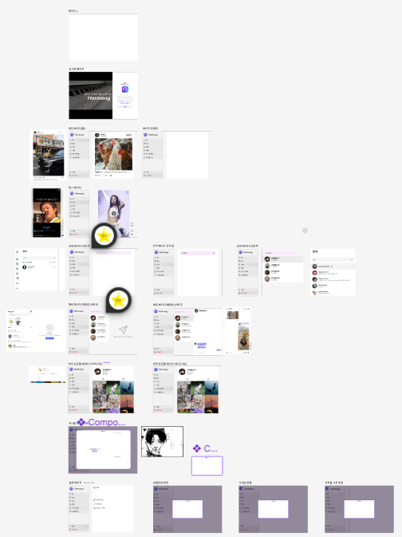
